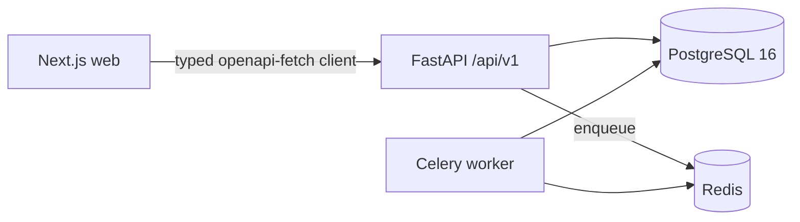

# CareLedger

Hospital financial management: patient billing, insurance claims, payments, AR/AP, a double-entry
general ledger, payroll, budgets and reporting. Portfolio project. **Demo system. Synthetic data
only. Not for real patient data.**

| Status | |
|---|---|
| Current phase | **1 – Ledger core** ✅ |
| Next | 2 – Patient billing |

See [docs/PHASES.md](docs/PHASES.md) for the per-phase checklist.

## Quick start (Docker, ~5 minutes)

Prerequisites: Docker Desktop (with `docker compose`).

```bash
cp .env.example .env          # optional; defaults work for local demo
docker compose up -d --build  # db, redis, api, worker, web
docker compose exec api python -m seed   # or: make seed
```

* Web: http://localhost:3000
* API docs (OpenAPI/Swagger): http://localhost:8000/api/docs
* Health: http://localhost:8000/api/v1/health

### Demo credentials

**Every demo user shares one password: `CareLedger!2026`** (configurable via `DEMO_PASSWORD`).
Sign in with the username or the email. The full list lives in
[docs/DEMO_USERS.md](docs/DEMO_USERS.md).

| Role | Username | Email |
|------|----------|-------|
| admin | `admin` | admin@careledger.example |
| billing_clerk | `billing` | billing@careledger.example |
| insurance_officer | `insurance` | insurance@careledger.example |
| accountant | `accountant` | accountant@careledger.example |
| finance_manager | `finance` | finance@careledger.example |
| auditor | `auditor` | auditor@careledger.example |

## Architecture



Backend layering is `routers -> services -> repositories -> models`; one HTTP request is one DB
transaction. Ledger posting rules, the claim state machine and the auto-posting account mapping
are in [docs/ARCHITECTURE.md](docs/ARCHITECTURE.md). Judgement calls are logged in
[docs/DECISIONS.md](docs/DECISIONS.md).

## Local development (without Docker for the apps)

Python packages always live in a virtual environment (`backend/.venv`); Node packages in
`frontend/node_modules`.

```bash
docker compose up -d db redis                 # or any Postgres 16 on :5432 (user/pass careledger)
python3.12 -m venv backend/.venv              # Windows: py -3.12 -m venv backend\.venv
backend/.venv/bin/pip install -e "backend[dev]"   # Windows: backend\.venv\Scripts\pip ...
cd backend && ../backend/.venv/bin/alembic upgrade head && ../backend/.venv/bin/python -m seed
../backend/.venv/bin/uvicorn app.main:app --reload --port 8000
# new terminal
cd frontend && npm ci && npm run dev
```

### Make targets

| Command | What it does |
|---|---|
| `make up` / `make down` | Start / stop the full Compose stack |
| `make migrate` | `alembic upgrade head` in the api container |
| `make seed` | Deterministic, idempotent synthetic data |
| `make test` | Backend pytest (needs Postgres on :5432) + frontend Vitest |
| `make e2e` | Playwright against a running, seeded stack |
| `make lint` / `make typecheck` | ruff + eslint + prettier / mypy (strict) + tsc |
| `make gen-client` | Export OpenAPI and regenerate `frontend/lib/api/schema.d.ts` |

On Windows without `make`, run the commands from the Makefile directly (they are one-liners).

## What works today

* **Phase 0**: login (username or email), role-aware navigation, user administration, audit log API.
* **Phase 1 – Ledger**: chart of accounts, fiscal periods with pre-close check and permanent lock,
  manual journal entries (approval above 10,000.00), reversals, trial balance, income statement,
  balance sheet and account ledger. The database itself rejects unbalanced, edited, deleted or
  closed-period postings.

Try it: sign in as `accountant`, post an entry under **Journal entries → New entry**, then open
**Financial reports**. Sign in as `finance` to approve an entry above the threshold.

## API conventions

* Versioned under `/api/v1`; JWT bearer auth (`/auth/login`, `/auth/refresh`, `/auth/logout`, `/auth/me`).
* Errors always use `{"error": {"code", "message", "details"}}`.
* Lists are paginated: `?page=1&page_size=25&sort=-created_at` → `{items, total, page, page_size}`.
* Money is `NUMERIC(14,2)` in the DB, `Decimal` in Python and a **string** in JSON (`"1250.00"`).
* Every endpoint enforces roles in the backend; auditors get read access everywhere.

## Testing

* Backend: pytest + httpx TestClient against real PostgreSQL (each test in a rolled-back
  transaction), Hypothesis for accounting invariants (from Phase 1). `alembic check` runs in CI.
* Frontend: Vitest + Testing Library for units, Playwright for E2E.
* CI (`.github/workflows/ci.yml`): lint, types, tests, generated-client drift check, and a
  `docker compose up --wait` smoke test.

## What a production deployment would require

This is a demo. A real deployment handling PHI/financial data would additionally need:

* **Compliance**: HIPAA (BAA with every vendor, risk assessment, minimum-necessary access),
  GDPR where applicable (lawful basis, data-subject rights, retention schedules).
* **Identity**: SSO/OIDC with MFA, per-user credentials (no shared demo password), session
  management with httpOnly cookies, account lockout and password policy.
* **Encryption**: TLS everywhere, encryption at rest (disk + database), field-level encryption
  for policy numbers and bank references, managed KMS keys with rotation.
* **Secrets management**: Vault / cloud secret manager; no secrets in env files.
* **Data protection**: automated encrypted backups, point-in-time recovery, tested restores,
  immutable audit-log archival (WORM storage).
* **Hosting**: HIPAA-eligible cloud, private networking, WAF, rate limiting, intrusion detection,
  centralized logging/alerting with PHI scrubbing.
* **Integrations**: real payer connectivity (X12 837/835 EDI via a clearinghouse), payment
  processor (PCI-DSS scope reduction via tokenization), bank feeds.
* **Operations**: segregation of duties reviews, change management, penetration testing.
