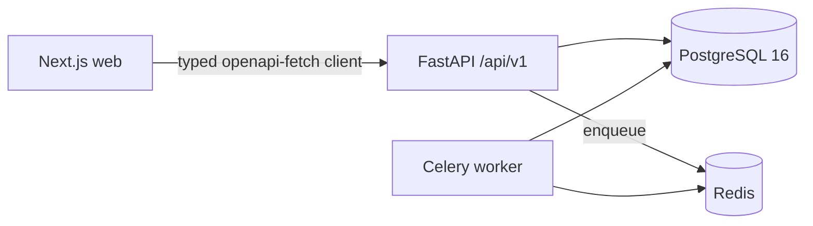

# CareLedger

Hospital financial management: patient billing, insurance claims, payments, AR/AP, a double-entry
general ledger, payroll, budgets and reporting. Portfolio project. **Demo system. Synthetic data
only. Not for real patient data.**

| Status | |
|---|---|
| Current phase | **5 – Payroll and budgets** ✅ |
| Next | 6 – Reporting and dashboards |

See [docs/PHASES.md](docs/PHASES.md) for the per-phase checklist.

## Quick start (Windows, native, no Docker, ~5 minutes)

CareLedger runs directly on Windows: PostgreSQL 16 as a Windows service, Microsoft Garnet as the
Redis-compatible broker, and the API, worker and web app as local processes. No Docker or
virtualization is needed.

**1. Install the prerequisites once** (PowerShell):

```powershell
winget install -e --id Python.Python.3.12
```

```powershell
winget install -e --id OpenJS.NodeJS.LTS
```

```powershell
winget install -e --id PostgreSQL.PostgreSQL.16 --override "--mode unattended --superpassword <choose-one> --serverport 5432"
```

```powershell
winget install -e --id Microsoft.Garnet.DN8
```

Put the PostgreSQL superuser password you chose into `.env` as `POSTGRES_SUPERUSER_PASSWORD=...`
(copy `.env.example` to `.env` first; `.env` is git-ignored). Setup uses it once to create the
`careledger` database role.

**2. Set up** (creates `backend\.venv`, installs dependencies, creates the database, migrates, seeds):

```powershell
powershell -ExecutionPolicy Bypass -File .\scripts\setup.ps1
```

**3. Run everything** (Garnet, API, Celery worker, web; each in its own minimized window):

```powershell
powershell -ExecutionPolicy Bypass -File .\scripts\dev.ps1
```

Add `-Production` to serve an optimized build. Stop everything with
`.\scripts\dev.ps1 -Stop`. Logs go to `logs\api.log`, `logs\worker.log` and `logs\web.log`.

* Web: http://localhost:3000
* API docs (OpenAPI/Swagger): http://localhost:8000/api/docs
* Health: http://localhost:8000/api/v1/health

### Demo credentials

**Every demo user shares one password: `CareLedger!2026`** (configurable via `DEMO_PASSWORD`).
Sign in with the username or the email. The full list lives in
[docs/DEMO_USERS.md](docs/DEMO_USERS.md).

| Role | Username | Email |
|------|----------|-------|
| admin | `admin` | admin@careledger.example |
| billing_clerk | `billing` | billing@careledger.example |
| insurance_officer | `insurance` | insurance@careledger.example |
| accountant | `accountant` | accountant@careledger.example |
| finance_manager | `finance` | finance@careledger.example |
| auditor | `auditor` | auditor@careledger.example |

## Architecture



Backend layering is `routers -> services -> repositories -> models`; one HTTP request is one DB
transaction. Ledger posting rules, the claim state machine and the auto-posting account mapping
are in [docs/ARCHITECTURE.md](docs/ARCHITECTURE.md). Judgement calls are logged in
[docs/DECISIONS.md](docs/DECISIONS.md).

## Developer scripts

Python packages always live in the virtual environment `backend\.venv`; Node packages in
`frontend\node_modules`. Nothing is installed globally.

| Script | What it does |
|---|---|
| `scripts\setup.ps1` | One-time setup (re-runnable): venv, dependencies, DB role and databases, migrations, seed |
| `scripts\dev.ps1` | Start Garnet, API (auto-reload), worker and web; `-Production` for a built web app; `-Stop` to stop |
| `scripts\seed.ps1` | Apply migrations and reload the deterministic, idempotent demo seed |
| `scripts\test.ps1` | ruff, mypy, pytest + coverage, `alembic check`, eslint, prettier, tsc, Vitest; `-E2E` adds Playwright; `-Fast` skips lint |
| `scripts\gen-client.ps1` | Export FastAPI's OpenAPI spec and regenerate the typed TS client |

If PowerShell refuses to run scripts, prefix with `powershell -ExecutionPolicy Bypass -File`.
The `Makefile` wraps the same commands for macOS/Linux.

## What works today

* **Phase 0**: login (username or email), role-aware navigation, user administration, audit log API.
* **Phase 1 – Ledger**: chart of accounts, fiscal periods with pre-close check and permanent lock,
  manual journal entries (approval above 10,000.00), reversals, trial balance, income statement,
  balance sheet and account ledger. The database itself rejects unbalanced, edited, deleted or
  closed-period postings.

* **Phase 2 – Billing**: synthetic patients and visits, service catalog with effective-dated
  prices, draft invoices with line discounts and tax, issue (posts AR and departmental revenue),
  partial payments, deposits, refunds with approval, void with reversal, PDF invoices and
  receipts. Payment endpoints are idempotent (`Idempotency-Key`).

* **Phase 3 – Claims**: fictional insurers and patient policies, coverage split (copay,
  deductible, coinsurance, annual limit), claims drafted from invoices, the full claim
  lifecycle with a deterministic mock insurer, denials and appeals with attachments,
  remittance CSV import with reconciliation and posting.

* **Phase 5 – Payroll and budgets**: employees and salary structures, income-tax slabs,
  monthly payroll runs calculated by a background job, approval, ledger posting by
  department, payment and payslip PDFs; department budgets with a variance report
  against the ledger and threshold alerts.

Try it (payroll): sign in as `finance`, open **Payroll**, open the November run and
approve it; as `accountant`, pay it. Open **Budgets** > Emergency 2026 to see the
salary overrun.

* **Phase 4 – AR / AP and approvals**: one approvals inbox with configurable thresholds,
  AR aging by patient and insurer, reminder (dunning) job, bad-debt write-offs, vendors,
  purchase orders, vendor bills with three-way match, scheduled and idempotent payments.

Try it (approvals): sign in as `finance`, open **Approvals** and approve the pending
write-off; as `accountant`, create a PO under **Payables**, record receipt, bill it and pay.

Try it (claims): sign in as `insurance`, open **Claims**, submit a draft, choose
**Run mock insurer** (pick partial approval or denial), appeal a denial, then import a
remittance CSV under **Remittances** and post it.

Try it: sign in as `billing`, open **Patients**, pick a patient, choose **New invoice**, add
charges, issue it and record a payment. Sign in as `finance` to approve the pending refund under
**Payments -> Refunds**. Sign in as `accountant`, post an entry under **Journal entries → New entry**, then open
**Financial reports**. Sign in as `finance` to approve an entry above the threshold.

## API conventions

* Versioned under `/api/v1`; JWT bearer auth (`/auth/login`, `/auth/refresh`, `/auth/logout`, `/auth/me`).
* Errors always use `{"error": {"code", "message", "details"}}`.
* Lists are paginated: `?page=1&page_size=25&sort=-created_at` → `{items, total, page, page_size}`.
* Money is `NUMERIC(14,2)` in the DB, `Decimal` in Python and a **string** in JSON (`"1250.00"`).
* Every endpoint enforces roles in the backend; auditors get read access everywhere.

## Testing

* Backend: pytest + httpx TestClient against real PostgreSQL (each test in a rolled-back
  transaction), Hypothesis for accounting invariants (from Phase 1). `alembic check` runs in CI.
* Frontend: Vitest + Testing Library for units, Playwright for E2E.
* CI (`.github/workflows/ci.yml`): lint, types, tests, `alembic check` and generated-client
  drift check, with PostgreSQL as a CI service.

## What a production deployment would require

This is a demo. A real deployment handling PHI/financial data would additionally need:

* **Compliance**: HIPAA (BAA with every vendor, risk assessment, minimum-necessary access),
  GDPR where applicable (lawful basis, data-subject rights, retention schedules).
* **Identity**: SSO/OIDC with MFA, per-user credentials (no shared demo password), session
  management with httpOnly cookies, account lockout and password policy.
* **Encryption**: TLS everywhere, encryption at rest (disk + database), field-level encryption
  for policy numbers and bank references, managed KMS keys with rotation.
* **Secrets management**: Vault / cloud secret manager; no secrets in env files.
* **Data protection**: automated encrypted backups, point-in-time recovery, tested restores,
  immutable audit-log archival (WORM storage).
* **Hosting**: HIPAA-eligible cloud, private networking, WAF, rate limiting, intrusion detection,
  centralized logging/alerting with PHI scrubbing.
* **Integrations**: real payer connectivity (X12 837/835 EDI via a clearinghouse), payment
  processor (PCI-DSS scope reduction via tokenization), bank feeds.
* **Operations**: segregation of duties reviews, change management, penetration testing.
