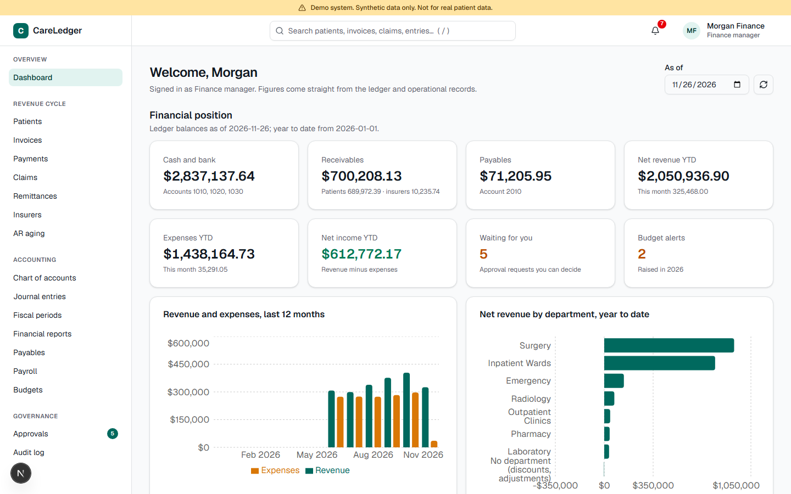
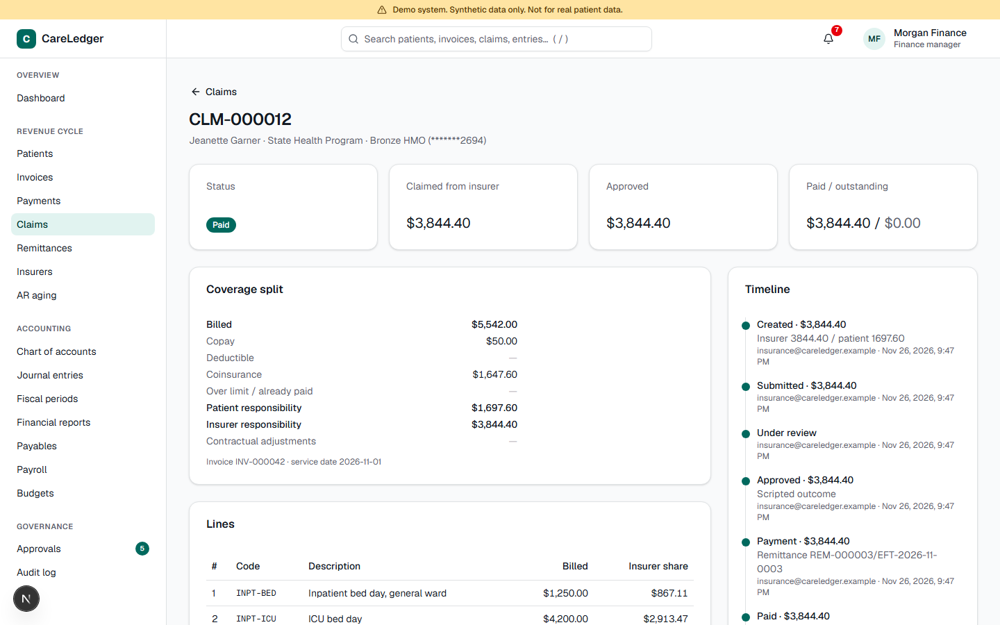
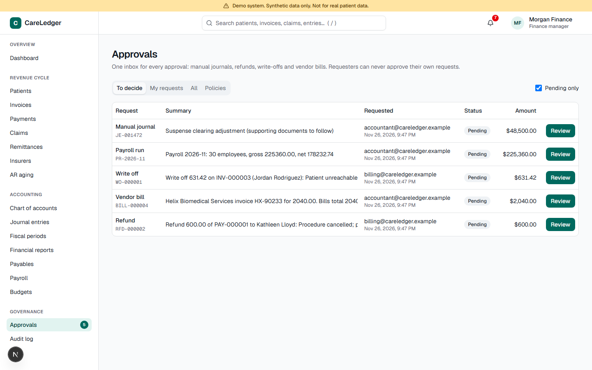
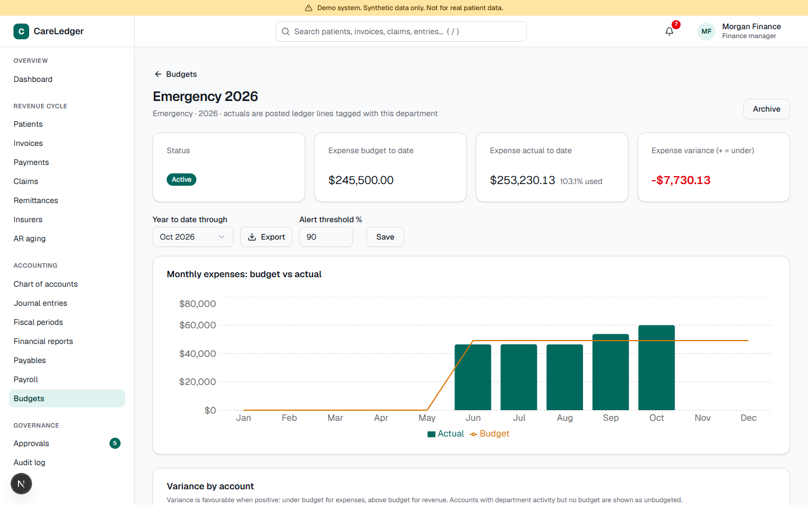
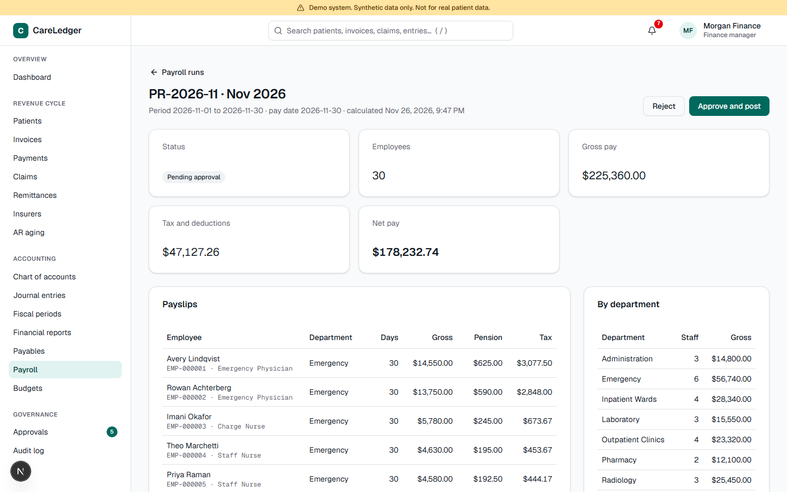
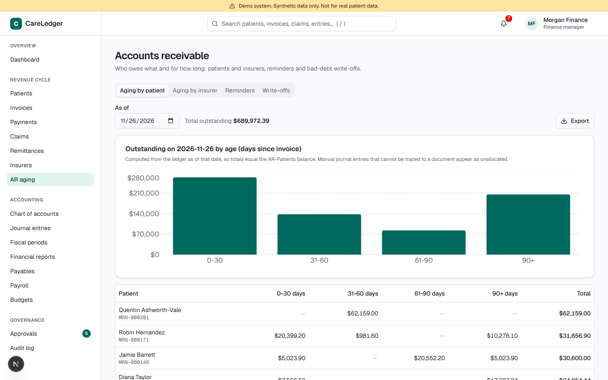
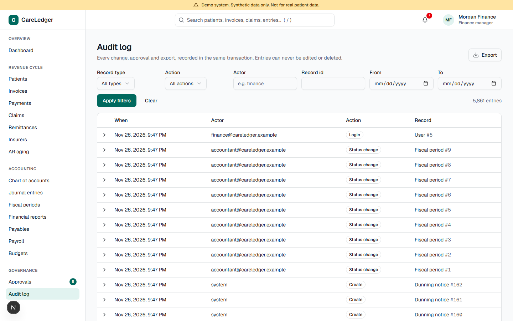
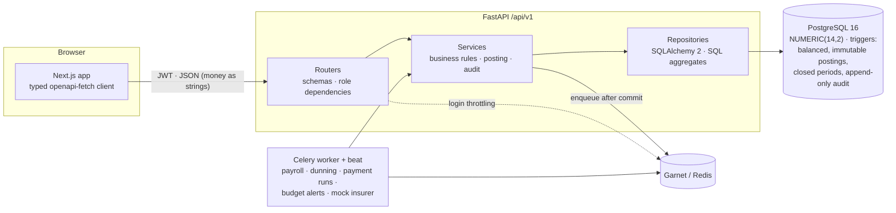

# CareLedger

Hospital financial management: patient billing, insurance claims, payments, accounts
receivable and payable, a double-entry general ledger, payroll, budgets, dashboards and an
audit trail. Portfolio project. **Demo system. Synthetic data only. Not for real patient data.**

| Status | |
|---|---|
| Build | **Phases 0–7 complete** ✅ (Phase 8, analytics, is an optional stretch) |
| Stack | FastAPI · SQLAlchemy 2 · PostgreSQL 16 · Celery · Next.js (App Router) · TypeScript · Tailwind · shadcn/ui |
| Tests | pytest 556 (95% coverage) · Vitest 33 · Playwright 31 (including the full demo script) |



| | |
|---|---|
|  |  |
|  |  |
|  |  |

## Quick start (Windows, native, about 5 minutes)

CareLedger runs directly on Windows: PostgreSQL 16 as a Windows service, Microsoft Garnet as the
Redis-compatible broker, and the API, worker and web app as local processes. No Docker or
virtualization is needed.

**1. Install the prerequisites once** (PowerShell):

```powershell
winget install -e --id Python.Python.3.12
```

```powershell
winget install -e --id OpenJS.NodeJS.LTS
```

```powershell
winget install -e --id PostgreSQL.PostgreSQL.16 --override "--mode unattended --superpassword <choose-one> --serverport 5432"
```

```powershell
winget install -e --id Microsoft.Garnet.DN8
```

Copy `.env.example` to `.env` and put the PostgreSQL superuser password you chose into it as
`POSTGRES_SUPERUSER_PASSWORD=...` (`.env` is git-ignored). Setup uses it once to create the
`careledger` database role.

**2. Set up** (creates `backend\.venv`, installs dependencies, creates the databases, migrates
and loads six months of demo data):

```powershell
powershell -ExecutionPolicy Bypass -File .\scripts\setup.ps1
```

**3. Run everything** (Garnet, API, Celery worker and web, each in its own minimized window):

```powershell
powershell -ExecutionPolicy Bypass -File .\scripts\dev.ps1
```

* Web: http://localhost:3000
* API docs (OpenAPI / Swagger): http://localhost:8000/api/docs
* Health: http://localhost:8000/api/v1/health

Add `-Production` to serve an optimized build; stop everything with `.\scripts\dev.ps1 -Stop`.
Logs go to `logs\api.log`, `logs\worker.log` and `logs\web.log`. To get the original demo data
back after a demo or an E2E run:

```powershell
powershell -ExecutionPolicy Bypass -File .\scripts\seed.ps1 -Reset
```

> **macOS / Linux:** the `Makefile` wraps the same steps (`make setup`, `make up`, `make seed`,
> `make seed-reset`, `make test`) with a local PostgreSQL 16 and Redis. A `docker-compose.yml`
> is included for convenience but was not exercised in this (Docker-free) build.

## Demo credentials

**Every demo user shares one password: `CareLedger!2026`** (configurable via `DEMO_PASSWORD`).
Sign in with the username or the email. The list is kept in
[docs/DEMO_USERS.md](docs/DEMO_USERS.md).

| Role | Username | What to try |
|------|----------|-------------|
| admin | `admin` | Users and roles, chart of accounts, audit log with exports |
| billing_clerk | `billing` | Patients, visits, invoices, payments, refunds, claim drafts, write-off requests |
| insurance_officer | `insurance` | Submit claims, run the mock insurer, appeals, remittance import |
| accountant | `accountant` | Journal entries, period close, payables, payroll runs, reports |
| finance_manager | `finance` | Approvals inbox, budgets, dashboards, notifications |
| auditor | `auditor` | Read-only access everywhere, including the audit trail |

## Demo script

Every step below is automated in [`frontend/tests/e2e/demo.spec.ts`](frontend/tests/e2e/demo.spec.ts).

1. Start the stack (quick start above) and sign in with the demo credentials.
2. **billing**: open a patient, add a **New visit**, choose **Bill**, add charges and
   **Issue invoice** (it posts AR and department revenue).
3. **insurance**: on the invoice choose **Create claim**, **Submit to insurer**, then
   **Run mock insurer**: one claim partially approved, one denied; **Appeal** the denial.
4. Record a patient payment on the invoice; under **Remittances** import an insurer CSV and
   post it; open **Journal entries** to see the resulting balanced entries.
5. **finance**: approve the pending write-off in **Approvals**.
6. Open the **Dashboard**: receivables by age, collection rate, revenue by department, budget
   use; open **Budgets → Emergency 2026** for the variance.
7. **accountant**: view the trial balance and income statement under **Financial reports**;
   close last month under **Fiscal periods**; try to post a journal entry dated in it and see
   it rejected.
8. **auditor**: open the invoice from step 2 and choose **Audit trail**.

### What the demo data contains

The seed is deterministic and idempotent: June to November 2026 of activity at a realistic
scale (about 780 invoices, 200 patients, around 330,000 a month in revenue), plus:

* claims in every state, partial approvals, denials, appeals and reconciled remittances;
* monthly payroll June–October paid, November **awaiting approval**; 31 employees including a
  mid-month joiner and a leaver;
* supplier bills, purchase orders with a three-way-match variance, scheduled payments;
* **January–September closed**; October left open so step 7 can close it;
* pending approvals: payroll, a bad-debt write-off, a large refund, a vendor bill variance, a
  manual journal;
* a **budget overrun** (Emergency salaries) and a warning (Surgery salaries);
* **anomalies** worth spotting: a 60,000+ unpaid ICU invoice ageing past 30 days, and a
  48,500.00 "suspense clearing" journal entry with no support waiting for approval.

## Architecture



* **Layering**: `routers → services → repositories → models`. One HTTP request (or job) is one
  database transaction; a business record, its journal entry, its audit rows and any
  notifications commit together or not at all.
* **Ledger**: double entry enforced twice, in the service layer and by deferred PostgreSQL
  constraint triggers; posted entries are immutable (corrections are reversals); closed periods
  reject postings; nothing is hard-deleted. Account mapping, posting rules and the claim state
  machine: [docs/ARCHITECTURE.md](docs/ARCHITECTURE.md).
* **Approvals**: one engine with runtime-configurable thresholds for manual journals, refunds,
  write-offs, vendor bills and payroll; requesters can never approve their own requests.
* **Judgement calls** (86 of them, with reasons): [docs/DECISIONS.md](docs/DECISIONS.md).

## Features

| Area | Highlights |
|---|---|
| Ledger | Chart of accounts, fiscal periods with pre-close check and permanent lock, manual entries with approval, reversals, trial balance, income statement, balance sheet, account ledger |
| Billing | Patients and visits, effective-dated price list, invoices with discounts and tax, payments, deposits, refunds with approval, voids by reversal, PDF invoices and receipts, idempotent payment endpoints |
| Insurance | Insurers and policies, coverage split (copay, deductible, coinsurance, annual limit), claim lifecycle with a deterministic mock insurer, denials, appeals with attachments, remittance CSV import with reconciliation |
| AR / AP | Ledger-derived aging by patient and insurer, dunning job, bad-debt write-offs, vendors, purchase orders, three-way match, scheduled and idempotent payments |
| Payroll | Salary structures, progressive tax slabs, proration, background calculation, approval, posting by department, payment, payslip PDFs |
| Budgets | Monthly budgets per department and account, variance from SQL aggregates, warning / exceeded alerts |
| Reporting | Role-based dashboards, CSV/PDF exports (audited), notifications, global search, audit viewer with field-level diffs |

## Security and hardening

* **Authorization** is enforced in the backend on every endpoint; the full role matrix is
  generated from the route table into [docs/AUTHORIZATION.md](docs/AUTHORIZATION.md), and tests
  prove every protected route rejects anonymous callers and every role outside its rule.
* **Login throttling**: 5 failed attempts per account or 20 per address in 15 minutes → `429`
  with `Retry-After` (Redis-backed, shared by all workers, in-memory fallback).
* **Data minimisation**: card numbers are never stored (last 4 only); bank references, tax IDs
  and policy numbers are masked for roles that do not need them; validation errors never echo
  submitted values.
* **Audit**: append-only (database trigger), written in the same transaction as the change,
  including approvals, exports and logins.
* **Performance**: list endpoints are tested to issue a constant number of queries regardless of
  page size (no N+1); indexes added where the query review found them missing.
* **Exports**: CSV cells that could be evaluated as spreadsheet formulas are neutralised.

## Testing

```powershell
powershell -ExecutionPolicy Bypass -File .\scripts\test.ps1 -E2E
```

* **Backend** (pytest, real PostgreSQL, each test in a rolled-back transaction): accounting
  invariants with Hypothesis, every posting rule, approval segregation, payroll arithmetic,
  the authorization matrix, query counts, and the full demo seed (balanced, reconciled,
  idempotent). `alembic check` keeps migrations and models in sync.
* **Frontend**: Vitest for money, validation and formatting helpers; Playwright for every
  module plus the eight-step demo script.
* **CI** (`.github/workflows/ci.yml`): ruff, mypy (strict), pytest with coverage, migration
  drift, generated-client drift, eslint, prettier, tsc and Vitest.

## Developer scripts

Python packages always live in the virtual environment `backend\.venv`; Node packages in
`frontend\node_modules`. Nothing is installed globally.

| Script | What it does |
|---|---|
| `scripts\setup.ps1` | One-time setup (re-runnable): venv, dependencies, DB role and databases, migrations, seed |
| `scripts\dev.ps1` | Start Garnet, API (auto-reload), worker and web; `-Production` for a built web app; `-Stop` to stop |
| `scripts\seed.ps1` | Apply migrations and load the deterministic, idempotent demo seed; `-Reset` starts from an empty database |
| `scripts\test.ps1` | ruff, mypy, pytest + coverage, `alembic check`, eslint, prettier, tsc, Vitest; `-E2E` adds Playwright; `-Fast` skips lint |
| `scripts\gen-client.ps1` | Export FastAPI's OpenAPI spec and regenerate the typed TypeScript client |
| `frontend\scripts\screenshots.mjs` | Re-capture the README screenshots from a running, freshly seeded stack |

If PowerShell refuses to run scripts, prefix with `powershell -ExecutionPolicy Bypass -File`.

## API conventions

* Versioned under `/api/v1`; JWT bearer auth (`/auth/login`, `/auth/refresh`, `/auth/logout`,
  `/auth/me`); refresh tokens rotate and are single-use.
* Errors always use `{"error": {"code", "message", "details"}}`.
* Lists are paginated: `?page=1&page_size=25&sort=-created_at` → `{items, total, page, page_size}`.
* Money is `NUMERIC(14,2)` in the database, `Decimal` in Python and a **string** in JSON
  (`"1250.00"`); floats are rejected.
* Payment endpoints accept an `Idempotency-Key` header.

## What a production deployment would require

This is a demo. A real deployment handling PHI and financial data would additionally need:

* **Compliance**: HIPAA (business associate agreements with every vendor, risk assessment,
  minimum-necessary access, breach procedures), GDPR where applicable (lawful basis,
  data-subject rights, retention schedules, DPIAs).
* **Identity**: SSO/OIDC with MFA, per-user credentials (no shared demo password), httpOnly
  session cookies, password policy, periodic access reviews.
* **Encryption**: TLS everywhere, encryption at rest (disk and database), field-level
  encryption for policy numbers and bank references, managed KMS keys with rotation.
* **Secrets management**: a vault or cloud secret manager; no secrets in environment files.
* **Data protection**: automated encrypted backups, point-in-time recovery, tested restores,
  immutable audit-log archival (WORM storage).
* **Hosting**: a HIPAA-eligible cloud, private networking, WAF and edge rate limiting,
  intrusion detection, centralized logging and alerting with PHI scrubbing.
* **Integrations**: real payer connectivity (X12 837/835 EDI through a clearinghouse), a payment
  processor with tokenization to reduce PCI-DSS scope, bank feeds, an email/SMS provider for
  reminders and notifications.
* **Operations**: segregation-of-duties reviews, change management, penetration testing,
  disaster-recovery drills.

## Documentation

* [docs/ARCHITECTURE.md](docs/ARCHITECTURE.md): layering, posting rules, account mapping, state machines
* [docs/DECISIONS.md](docs/DECISIONS.md): every judgement call and why
* [docs/AUTHORIZATION.md](docs/AUTHORIZATION.md): generated role matrix for every endpoint
* [docs/PHASES.md](docs/PHASES.md): per-phase checklists
* [docs/DEMO_USERS.md](docs/DEMO_USERS.md): demo accounts
