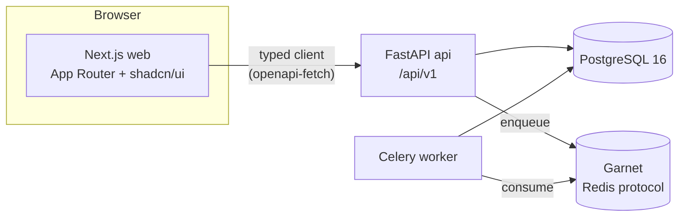
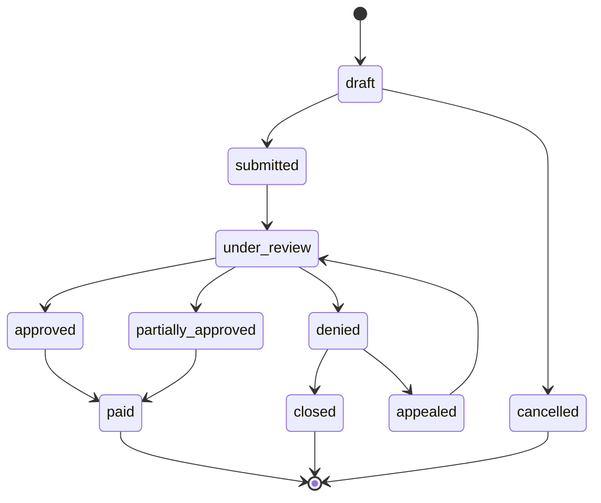

# CareLedger Architecture

CareLedger is a hospital **financial** management system (not clinical). This document is the
source of truth for layering, ledger posting rules, the claim state machine and the account
mapping used by auto-posting. Keep it updated as phases land.

## 1. System overview



Runs natively on Windows (no Docker; see DECISIONS #28). `scripts\dev.ps1` starts everything.

| Process | How it runs | Purpose |
|---------|-------------|---------|
| PostgreSQL 16 | Windows service `postgresql-x64-16` | All state, plus DB-level accounting safeguards. |
| Garnet | `GarnetServer.exe` on 127.0.0.1:6379 | Redis-protocol broker / result backend for Celery. |
| API | `uvicorn app.main:app` from `backend\.venv` | FastAPI (sync SQLAlchemy 2.0 + psycopg 3); migrations applied by `dev.ps1`. |
| Worker | `celery -A app.jobs.worker worker --pool=solo` | Invoicing runs, payroll runs, report generation, mock insurer, dunning. |
| Web | `next dev` / `next start` | Next.js frontend on :3000. |

## 2. Backend layering

```
routers (app/api/v1)  ->  services (app/services)  ->  repositories (app/repositories)  ->  models (app/models)
```

* **Routers** are thin: parse request (Pydantic schema), call one service function, return a
  response schema. They declare authorization with role dependencies. No business rules.
* **Services** own every business and accounting rule: state machines, validation, ledger
  posting, approvals, audit records. Services never commit; they `flush()`.
* **Repositories** hold queries (select/filter/paginate/aggregate). No rules.
* **Models** are SQLAlchemy 2.0 typed (`Mapped[...]`) declarative classes.

### Unit of work / transactions

One HTTP request = one database transaction. The `get_db` dependency opens a session, yields
it, **commits once** when the endpoint returns successfully and rolls back on any exception.
Because services only flush, a business record, its journal entry and its audit-log rows are
always written atomically (rule 5 and rule 11). Background jobs use the same pattern via
`session_scope()`.

### Cross-cutting

* **Errors**: every error leaves the API as `{"error": {"code", "message", "details"}}`.
  Services raise `AppError` subclasses (`NotFound`, `Conflict`, `ValidationFailed`,
  `PermissionDenied`, `BusinessRuleViolation`). DB safeguard violations raised by triggers are
  mapped to `409 ledger_violation`.
* **Auth**: JWT access token (short-lived, 15 min) + refresh token (7 days) stored by `jti` in
  `refresh_tokens` so logout/rotation can revoke it. Passwords hashed with argon2.
* **RBAC**: `require_roles(...)` dependency on every endpoint. Read endpoints use
  `read_roles(...)`, which always also admits `auditor`. The UI hides controls for usability
  only; the backend is the security boundary.
* **Audit log**: `audit.record(...)` writes actor, timestamp, entity, action, before/after JSON in
  the caller's transaction. `audit_log` is append-only (DB trigger rejects UPDATE/DELETE).
* **Money**: `NUMERIC(14,2)` columns, `Decimal` in Python, serialized as strings in JSON
  (`app.core.money.Money`). Floats are never used.
* **Pagination**: list endpoints take `page`, `page_size` (max 200), `sort`, and module filters,
  and return `{items, total, page, page_size}`.
* **Idempotency**: payment-creating endpoints accept `Idempotency-Key`; the key, request hash
  and stored response live in `idempotency_keys` (Phase 2).

## 3. Ledger posting rules

1. Every journal entry has **at least 2 lines**; each line is either a debit or a credit
   (exactly one side > 0, the other = 0); `sum(debit) == sum(credit)`.
2. Enforcement is two-layered:
   * service layer (`ledger.post_entry`) validates before writing;
   * database: a **deferred constraint trigger** on `journal_lines` checks, at commit, that each
     touched entry balances and has 2+ lines.
3. Posted entries are **immutable**: triggers reject UPDATE/DELETE on `journal_lines` and on
   posted `journal_entries` (except none – status never changes after posting).
   Corrections = `ledger.reverse_entry(entry_id, reason)`, which posts a mirror entry
   (debits and credits swapped) linked via `reversal_of_id`.
4. Posting date must fall in an **open** fiscal period (checked in service and by trigger).
5. Every posting happens in the same transaction as its source business record
   (`source_type`, `source_id` on the entry).
6. Financial records are never hard-deleted (status fields / `deleted_at`).

### Implementation (Phase 1)

| Concern | Service (`app/services/ledger.py`) | Database (migration `0004_ledger`) |
|---|---|---|
| >= 2 lines, one-sided, 2 dp | `validate_lines` | `ck_journal_lines_one_sided`, `ck_journal_lines_non_negative`, deferred trigger `journal_lines_balanced` |
| Debits = credits | `validate_lines` → `unbalanced_entry` | deferred constraint triggers `journal_lines_balanced` / `journal_entries_balanced` |
| Immutability | no update paths for posted entries | `journal_lines_immutable`, `journal_entries_guard` (no DELETE ever, no UPDATE once posted) |
| Open period | `require_open_period` (row lock `FOR SHARE`) | `journal_entries_open_period` (also `FOR SHARE`, serialises with close) |
| Period lock | `periods.close_period` pre-check | `fiscal_periods_guard` (no reopen, no delete), `fiscal_periods_no_overlap` exclusion |
| Header accounts | `validate_lines` → `header_account` | — |

Entry lifecycle: `post_entry` writes `posted` directly. Manual entries (`create_manual_entry`)
above `MANUAL_JOURNAL_APPROVAL_THRESHOLD` are written `pending_approval` and become `posted` only
via `approve_entry` by a finance manager who is not the creator (or `rejected`). Pending and
rejected entries never affect reports. Entry numbers come from the `journal_entry_number_seq`
sequence (`JE-000001`).

Reports (`app/services/reports.py`) aggregate posted lines in SQL (`SUM ... GROUP BY`); the
account ledger computes its running balance with a window function. The balance sheet adds a
computed retained-earnings line (cumulative revenue − expenses), so
`assets = liabilities + equity` always holds.

Period close pre-check: trial balance for the period balances, no `pending_approval` entries in
the period, and all earlier periods are closed.

## 4. Auto-posting account mapping

Account codes come from the seeded default hospital chart of accounts (Phase 1).

| Event | Debit | Credit |
|-------|-------|--------|
| Invoice issued | 1100 AR – Patients (invoice total) ; 4910 Patient Discounts (discount) | 41xx Department revenue (gross line amounts, per department) ; 2300 Sales Tax Payable (tax) |
| Invoice voided | reversing entry of the issue entry | |
| Patient payment – cash | 1010 Cash on Hand | 1100 AR – Patients |
| Patient payment – card / bank transfer | 1020 Bank – Operating | 1100 AR – Patients |
| Patient deposit (unapplied) | 1010 / 1020 | 2200 Patient Deposits |
| Deposit applied to invoice | 2200 Patient Deposits | 1100 AR – Patients |
| Refund of an invoice payment | 1100 AR – Patients | 1010 / 1020 (or 2200 if the payment came from a deposit) |
| Refund of a deposit (unapplied part only) | 2200 Patient Deposits | 1010 / 1020 |
| Claim submitted (insurer portion moved) | 1110 AR – Insurers | 1100 AR – Patients |
| Remittance received | 1020 Bank – Operating (paid) | 1110 AR – Insurers |
| Partial approval (shortfall, at adjudication) | 4900 Contractual Adjustments | 1110 AR – Insurers |
| Short pay accepted (unpaid remainder) | 4900 Contractual Adjustments | 1110 AR – Insurers |
| Denied claim closed – balance back to patient | 1100 AR – Patients | 1110 AR – Insurers |
| Write-off (bad debt) | 5400 Bad Debt Expense | 1100 / 1110 |
| Vendor bill approved | 5xxx expense per bill line | 2010 Accounts Payable |
| Vendor payment | 2010 Accounts Payable | 1020 Bank – Operating |
| Payroll run posted | 5100 Salaries & Wages (gross) | 2110 Payroll Tax Payable ; 2120 Other Deductions Payable ; 2100 Salaries Payable (net) |
| Payroll paid | 2100 Salaries Payable | 1020 Bank – Operating |

### Billing implementation (Phase 2)

* `services/posting.py` is the single place that maps business events to accounts; the
  invoice/payment services call it and `ledger.post_entry` in the same transaction.
* Invoice issue credits each line's **gross** amount to its department's revenue account
  (`departments.revenue_account_id`; departments without one use 4950 Other Income), tagging the
  journal line with `department_id`. Discounts post separately to 4910 so gross revenue stays
  visible.
* Line arithmetic (`services/billing_math.py`): `gross = round(qty x price)`,
  `discount = round(gross x pct)`, `tax = round((gross - discount) x rate)`, ROUND_HALF_UP to
  cents at every step; invoice totals are sums of rounded lines (CHECK constraints enforce
  `total = subtotal - discount + tax` on invoices and lines).
* Catalog lines are priced from the invoice's price list on the line's service date
  (effective-dated `price_list_items`, no overlaps via a btree_gist exclusion constraint).
* Money movements: payments (cash -> 1010; card/bank -> 1020), deposits (-> 2200), deposit
  application (2200 -> 1100), refunds (reverse of the original movement). Refunds above
  `REFUND_APPROVAL_THRESHOLD` (500.00) wait for a finance manager who did not request them.
* DB guards (migration 0007): invoice lines frozen once the invoice leaves draft; issued invoice
  amounts immutable; void invoices immutable; invoices, payments and refunds never deleted.
* Idempotency (`services/idempotency.py`, table `idempotency_keys`): `POST /payments`,
  `POST /invoices/{id}/apply-deposit` and `POST /payments/{id}/refunds` accept
  `Idempotency-Key`. Same key + same body -> stored response, nothing re-executed; same key +
  different body -> 422 `idempotency_key_reused`; a failed attempt rolls back its key.

### Claims implementation (Phase 3)

* **Coverage** (`services/coverage.py`, pure): copay → deductible (calendar-year, net of claims
  already filed) → coinsurance (`round(after_deductible x coverage%)`) → annual-limit cap; the
  excess over the limit is patient responsibility. `insurer + patient == billed` always
  (property-tested). If the patient already paid part of the invoice, the insurer share is capped
  at what is still collectible. Claim lines get the insurer share by largest-remainder allocation.
* **Invoice fields**: `insurance_pending` (sitting in AR-Insurers) and `adjusted_amount`
  (contractual adjustments, later write-offs). `balance_due = total - paid - adjusted`;
  `patient_due = balance_due - insurance_pending`. Patients can only pay `patient_due`.
* **Ledger**: submit moves the insurer share 1100 → 1110; partial approval posts the shortfall as a
  contractual adjustment (4900 / 1110) at adjudication; remittance payments post 1020 / 1110;
  accepting a short pay posts the unpaid remainder to 4900; closing a denied claim moves the share
  back 1110 → 1100. Invariant (tested): balance of 1110 == sum of `invoices.insurance_pending`.
* **Mock insurer** (`services/mock_insurer.py`): per-insurer approval / partial / denial rates;
  the outcome is deterministic per (claim number, appeal round); a scripted `outcome` can be passed
  for demos. Available as `POST /claims/{id}/adjudicate`, `POST /claims/run-mock-insurer` and the
  Celery task `careledger.mock_insurer`.
* **Appeals**: denied → appealed (note required, max 2) → under_review again. Attachments
  (PDF / PNG / JPEG / text, ≤ 5 MB, magic-byte checked) are stored in `claim_attachments` and
  downloaded with `Content-Disposition: attachment` and `nosniff`.
* **Remittances** (`services/remittances.py`): CSV `claim_number,paid_amount[,remark]` →
  reconcile (matched / short_paid / overpaid / unmatched) → post matched and short-paid lines as
  insurer payments (idempotent; re-validated at post time). Overpaid and unmatched lines are never
  posted automatically. One remittance per (insurer, payer reference).
* **DB guards** (migrations 0010/0011): `claim_events` append-only; claims, remittances and their
  lines never deleted; CHECKs keep `insurer + patient = billed`, `approved <= claimed`,
  `paid + adjusted <= claimed`, and the invoice balance constraints.

### Approvals, AR and AP (Phase 4)

* **Approval engine** (`services/approvals.py`): `approval_policies` hold, per kind
  (`manual_journal`, `refund`, `write_off`, `vendor_bill`), the threshold (approval needed when
  the amount is strictly above it), the approver role and an active flag; admins and finance
  managers edit them at runtime. Domain services call `needs_approval()` / `request()`;
  `decide()` enforces requester != approver and the approver role, requires a note to reject,
  and dispatches to the kind's handler. Domain endpoints (e.g. journal approve) call
  `record_decision()` so the inbox stays in sync. Comments are kept per request.
* **AR aging** (`services/ar.py`, SQL `CASE` aggregates): patient balances (`patient_due`) aged
  from the invoice date; insurer balances (claimed − paid − adjusted on open claims) aged from
  submission. Buckets 0-30 / 31-60 / 61-90 / 90+ with inclusive bounds; documents dated after
  `as_of` are excluded. The insurer aging total equals the AR-Insurers balance.
* **Dunning**: daily job (`careledger.dunning_run`) and `POST /ar/dunning/run` create one
  simulated reminder per invoice per level (1-30, 31-60, 61+ days past due).
* **Write-offs**: patient balance only; Dr 5400 Bad Debt / Cr 1100 on approval, increasing
  `invoices.adjusted_amount`. Policy threshold defaults to 0 (every write-off needs approval).
* **AP**: purchase orders (draft → issued → received → closed / cancelled), bills with a
  three-way match (`no_po`, `matched`, `not_received`, `variance` when bills on a PO exceed it),
  approval when unmatched or above the vendor-bill threshold (5,000.00), posting
  Dr expense lines / Cr 2010 on approval, payments Dr 2010 / Cr 1020 (idempotent), scheduled
  payment runs (`careledger.vendor_payment_run`). The 2010 balance equals open bills (tested).

## 5. Claim state machine



Every transition writes a `claim_events` row and an audit-log row. Invalid transitions raise
`409 invalid_transition`.

## 6. Invoice lifecycle

`draft -> issued -> partially_paid -> paid`, and `draft|issued -> void` (void only when no
net payments remain; issued invoices post a reversing entry).

## 7. Frontend

Next.js App Router with route groups per module under `app/(app)/...`, a role-aware sidebar and
a persistent demo banner. All API types come from `lib/api/schema.d.ts`, generated from
FastAPI's OpenAPI spec (`make gen-client`); the client is `openapi-fetch`. Business logic stays
in the backend; components only present data.
